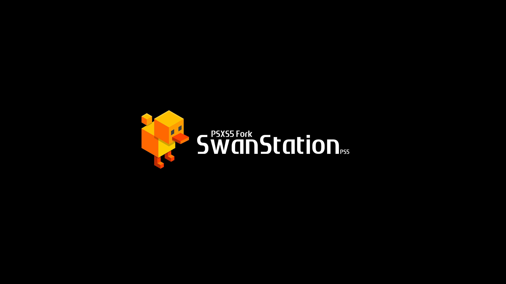
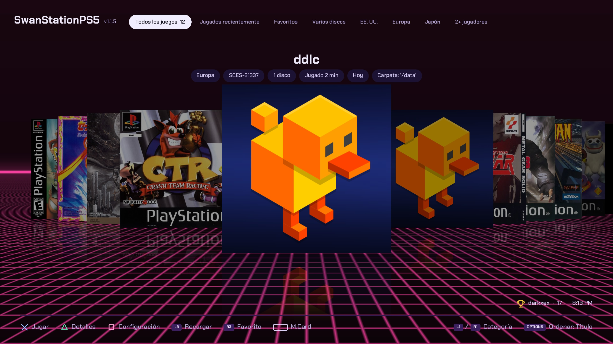
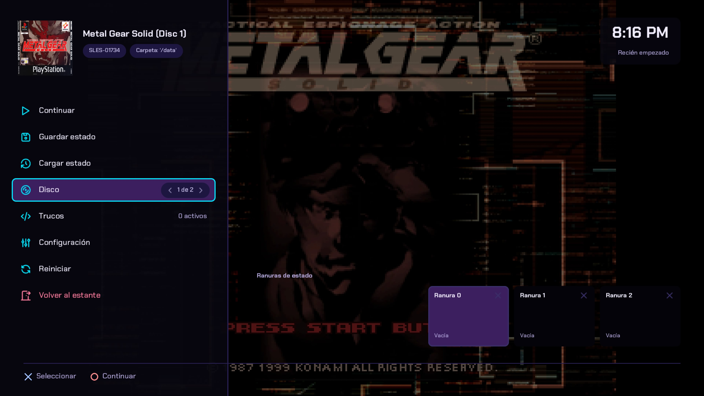
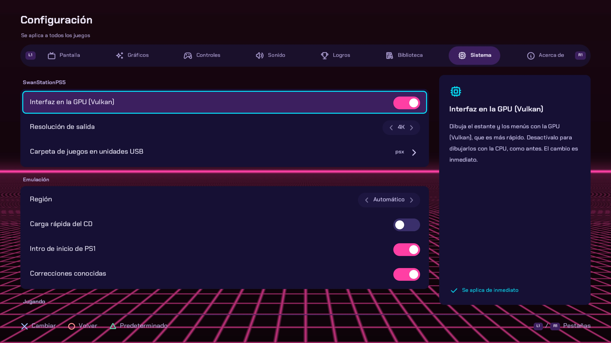
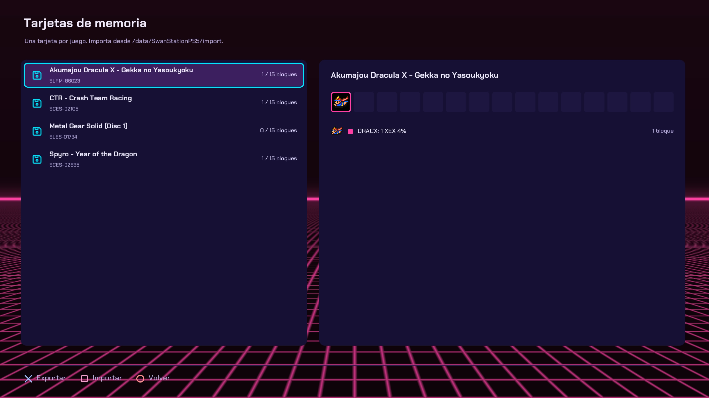

<p align="center">
  
</p>


<p align="center">
  
  <a href="https://github.com/darkxex/SwanStationUWP/releases"></a>
  
  
  
  
</p>

---

## What is SwanStationPS5?

SwanStationPS5 is a PlayStation 1 emulator that installs as an app on the PS5 home screen. It started as a fork of [PSXS5](https://github.com/SynoPiia/PSXS5) by SynoPiia, and it is no longer one. PSXS5 draws its interface on the CPU, with SDL2's software renderer into a canvas that Vulkan only displays; SwanStationPS5 is now 100% Vulkan, the game's picture and the whole interface drawn by the GPU, so the two frontends no longer line up. It runs every game on SwanStation.

Its frontend (the shelf, menus, controls and tools) began as PSXS5's and has been reworked since to be 100% Vulkan. It drives the SwanStation core: SwanStation is the only emulator.

- The emulator is [SwanStation](https://github.com/libretro/swanstation) (DuckStation's libretro core): accurate, and drawn on the PS5's GPU through Vulkan at up to 16x the PS1's resolution, with PGXP. It runs without a BIOS dump on its built-in OpenBIOS, but `SCPH1001.BIN` is highly recommended for good emulation.
- You pick a game from a cover-flow shelf with your covers.
- RetroAchievements, cheats for every game, save states and quick resume.

## Also on Xbox Series X|S

SwanStation is also available for the **Xbox Series X|S** as a UWP app: [SwanStationUWP](https://github.com/darkxex/SwanStationUWP). Download it from its [releases](https://github.com/darkxex/SwanStationUWP/releases) page. It needs the console in Xbox **developer mode**. Each release carries the app package (`.msix`), its signing certificate (`.cer`) and the `Microsoft.VCLibs` x64 dependency: trust the certificate, install the dependency, then install the package.

SwanStationUWP is a separate project with its own releases and issues; everything else in this README is about the PS5 app.

## Screenshots

<p align="center">
  
</p>
<p align="center">
  
   System > SwanStationPS5: the GPU interface and the USB games folder" width="32%">
  
</p>

## Highlights

- **The shelf and menus on the GPU too.** The interface is drawn through Vulkan, with a floor reflection under every cover. When you start a game, the case's lid opens and the CD spins, with the sound of a disc spinning up.
- **Always 4K.** The picture is sent to the TV at 4K, and it falls back to 1080p if the TV lacks the mode.
- **Up to 16x resolution on the GPU.** SwanStation renders through Vulkan: native, 2x, 4x, 8x or 16x (4x by default), at full speed.
- **No more wobbly 3D.** PGXP (precise geometry) keeps polygons still and textures straight.
- **One emulator, nothing to choose.** Every game runs on SwanStation. Memory cards are saved per game.
- **SwanStation's own options.** 104 of its core options (MSAA, texture filter, widescreen hack, PGXP details, controller ports, CPU overclock...) in Settings → Display, Graphics, Controls and System. They are in English and only on the console.

- **Five themes.** Neon Arcade (the default), Classic, Memory Card (light and dark, a grid of covers) and Record Shelf (spines on a shelf), each with its own colours and fonts. Around a 4:3 picture: black, the current background or a 90s TV, or the game's own artwork frame (off by default).
- **Games on a drive, by one name.** *Games folder on drives* (`psx` by default, typed with an on-screen keyboard) is looked for on `/mnt/ext0/`, `/mnt/ext1/` and `/mnt/usb0/` to `/mnt/usb7/` at once, so it still works when the console numbers your drives differently.
- **Games on an NFS server.** Keep your games on a PC or a NAS and play them over the network: add the server in Settings > System > NFS shares. They show on the shelf like a drive's, a background thread reads the disc ahead of the game, and a server that goes away just takes you back to the library. See [Games on an NFS server](#games-on-an-nfs-server).
- **Play your own PS1 discs from a USB CD drive.** Put a PS1 disc in a USB CD drive and SwanStationPS5 copies it to your games folder (a `.bin` and a `.cue`, with a progress bar and the game's cover), adds it to the shelf and starts it. Once a disc is installed, putting it in again just starts the game. With the disc daemon this works even with the app closed. See [Playing from a USB CD drive](#playing-from-a-usb-cd-drive).
- **Discs without opening the app.** Send `SwanStationPS5-DiscDaemon.elf` (a file of the release) once to your console's ELF loader and leave it running: a disc put in the drive is installed with the console's own notifications (name, percentage and time left), and then the game opens by itself.
- **Multi-disc games.** Change disc from the in-game menu and it happens as soon as you choose; the disc you leave a game on is the one it starts on next time. A `.m3u` playlist of `.chd` discs gets its serial (and so its cover and data) from the first disc's name.
- **Analog mode on at start.** A DualShock starts in analog mode in the games that use the sticks, unless the game's entry says to start in digital mode (the ANALOG button combo still switches it).
- **The DualSense as a light gun.** Point the controller at the screen in GunCon games (Time Crisis, Point Blank...); R2 fires.
- **Adaptive triggers.** R2 feels like a gas pedal in racing games, and R2 / L2 can be the gas and brake.
- **Profiles.** Each person keeps their own memory cards, save states, settings, play time and RetroAchievements sign-in.
- **Text guides and manuals.** Read a walkthrough `.txt` or a manual's pages from the in-game menu.
- **Game art.** Title screens and gameplay pictures in Details, and the game's own artwork around the picture.
- **Quick resume.** Leave a game and pick it up later: the shelf offers *Continue* (with a picture of where you were) or *Start over*.
- **Rewind and fast forward.** Hold the touchpad and press L2 to go back a few seconds, or R2 to speed through cutscenes.
- **Save states with pictures.** Ten slots per game, each showing a thumbnail and how long ago it was saved.
- **Widescreen.** SwanStation's widescreen hack (Settings → Graphics) draws the 3D picture in 16:9.
- **CRT look.** Light or strong scanlines, and the current background or a 90s TV around the picture.
- **Shaders for the picture** (Settings → Display → Shader): LCD3x (a handheld's LCD) and zfast LCD, four NTSC ones (320px or 256px, S-Video or Composite) that recreate the analog TV signal, and CRT looks: CRT Royale Fast and CRT Royale (detailed, with bloom and a phosphor mask; heavy), CRT Newpixie, CRT Hyllian NTSC, CRT Mattias, CRT Lottes and CRT Pi.
- **Generate frames.** AMD FSR 3's frame interpolation adds frames between the game's real ones. x2 puts one between each two: a 30 fps game is shown at 60, and with *Video output* at 120 Hz a 60 fps one at 120. x4 puts three: with *Video output* at 120 Hz a 30 fps game is shown at 120. At 60 Hz it only doubles. SwanStation tells the app when a picture is a repeat, so it starts from the game's real rate. The shaders run after it, CRT Royale Fast and NTSC included.
- **Show FPS that tells the truth.** It shows the emulated frames, the game's own rate when the game repeats pictures (`60.0 FPS (game 25.0)`) and, while frames are generated, the frames you actually see and how many are made for each of the game's (`100.0 FPS (game 25.0) | FG x4`).
- **HD texture packs.** The *Load HD textures* switch turns on SwanStation's texture replacement; put a pack's PNG files in `/data/SwanStationPS5/cache/textures/<serial>/` (for example `SCUS-94900`).
- **PS1 homebrew.** Homebrew discs boot too: [Yume Nikki PS1](https://eliasdaler.itch.io/yume-nikki-ps1) and [Doki Doki Literature Club PSX](https://www.psxhomebrewgames.com/2025/09/doki-doki-literature-club-psx.html) are confirmed.
- **PSXS5 friendly.** It still reads PSXS5's games and BIOS folders (see [supported folders](#supported-folders-for-games-and-bios)), so a PSXS5 library keeps working.
- **Close the app from the controller.** Hold O for 2 seconds. Menus show the title from the game database, and the game menu has pills with the serial and the folder.
- **Up to 4 players.** A multitap for the games that support it: each PS5 controller is a player.
- **Fan translations.** Put a `.ppf` patch next to a game and SwanStationPS5 applies it when the game starts.
- **Memory card manager.** See the saves on every game's card with each save's own icon (animated, as on a PS1), export cards for other emulators, import `.mcr`, `.mcd`, `.srm` or `.gme` cards.
- **Achievements list.** Every achievement of the game you're playing, with badges, in two tabs: *Achievable* (closest first) and *Achieved*.
  - Counted achievements (18/80 dragons) show a progress bar, and a small tracker pops up in game when they move.
- **Settings from your phone.** Turn it on and scan the QR code: a settings page opens on any phone on the same network.
- **Updates from GitHub.** SwanStationPS5 finds a new release when it starts and installs it by itself a second after opening (or from *Settings → About*), into the folder the app is running from: `/data/homebrew`, or an extended or USB drive. After an update it asks once whether to start from the new version's factory settings (✕ resets, ○ keeps yours).
- **Native app.** A real home-screen title (`PPSA98510`) with its own icon and art. Nothing is streamed and no PC is needed while you play.
- **A shelf for your games.** A cover flow with depth, 3D jewel cases, a reflection under every cover and a soft click as you browse.
  - Covers are matched by the serial read from each disc, so every region gets its own art.
  - Missing covers download on the console.
  - Your own art wins: a `cover.png`/`.jpg` in the game's folder, or an image in `/data/SwanStationPS5/covers/` named like the game's title, its disc file or its serial (`Crash Bandicoot.png`, `SCUS-94900.jpg`).
  - Or pick one by hand: on the shelf press **Triangle** (Details), then **Square**, and choose any image from `covers/` or the game's folder.
- **Plays every common format.** `.cue`/`.bin`, `.chd`, `.pbp` (including multi-disc), `.iso`, `.img`, `.mdf`, `.ccd` and `.m3u` playlists for multi-disc games.
- **Sharp on a 4K TV.**
  - Output: 1080p, 1440p or 4K (Settings → System → SwanStationPS5), changed at once.
  - Internal resolution: native up to 16x with SwanStation.
  - Aspect ratio: auto, 4:3, 16:9, 16:10, 1:1 pixels or stretch, and *Crop black edges* to hide the black lines at the top and bottom.
  - *Manual crop*, under Aspect ratio: open the preview with the touchpad, and Left / Right stretch or narrow the picture (always keeping its aspect ratio, which is shown) while Up / Down move it up or down. Square goes back to the original area.
  - Integer scaling and smooth final scaling on or off (sharp pixels by default).
- **Built for full speed.** 60 fps (50 for PAL games). SwanStation renders on the GPU, and so do the shelf and the menus; everything reaches the TV through Vulkan.
- **RetroAchievements.** Earn [RetroAchievements](https://retroachievements.org) as you play.
  - Unlocks and leaderboard results pop up on screen.
  - Optional hardcore mode.
  - See [RetroAchievements](#retroachievements).
- **Cheats for every game, automatically.** SwanStationPS5 knows all 1,961 PlayStation cheat files of libretro-database (GameShark, Action Replay...), and DuckStation's cheat database (about 4,500 more files) for games libretro has nothing for.
  - When a game starts it finds that game's file and downloads it: no setup.
  - Toggle codes per game from the in-game menu.
- **Save states.** 10 slots per game, plus memory cards saved per game.
- **DualSense ready.**
  - The classic digital pad by default, or the DualShock with analog sticks and rumble (Settings → Controls → Controller).
  - On digital-only games, the left stick drives the D-pad.
  - Cross confirms and Circle goes back in the menus.
- **Your BIOS, or none.** SwanStation works best with a BIOS dump of your own console for the game's region (`scph5500.bin` Japan, `scph5501.bin` USA, `scph5502.bin` Europe in `bios/`; the PC tool names them for you). Without one, SwanStation uses its built-in OpenBIOS, which is less compatible.
- **Five languages.** English, Français, Português (Portugal), Español (Latinoamérica) and 日本語, under Settings → System → Language.
- **Quiet interface sounds.** Five styles (Soft, Wood, Pop, Chime, Classic), a volume setting, or off.
- **A PC tool for your library.** `tools/SwanStationPS5_sync.py` prepares your games on Windows and uploads them over FTP:
  - unpacks archives
  - writes missing `.cue` sheets and `.m3u` playlists
  - fetches covers and cheats
- **Logs that help.** A session log and a crash report (with addresses for the symbol map) stay on the console.

## Playing from a USB CD drive

The PS5 has no laser for CDs, so PS1 discs are played from an external **USB CD drive**. SwanStationPS5 does not read the disc while you play: it **installs** it first (copies it to `.bin` and `.cue` in your games folder, the same as a dump you made yourself) and plays that copy. That way the game runs at full speed and works with every feature (save states, rewind, cheats, RetroAchievements). It only copies discs you own.

### The flow, with the disc daemon (the app can be closed)

1. **Once per console start**, send the payload `SwanStationPS5-DiscDaemon.elf` (it is attached to every [release](../../releases/latest), next to the zip; it is not inside the zip) to the ELF loader of your console, with the app closed:
   ```bash
   socat -t 99999999 - TCP:<PS5 IP>:9021 < SwanStationPS5-DiscDaemon.elf
   ```
   A notification says it is ready. Leave it running; sending a newer copy replaces the old one.
2. **Plug in the USB CD drive and put in a PS1 disc.** The console's own notifications show `Installing <game>: 37% - 5 min 30 s left...`. The time left comes from the speed the drive has just had, since a CD reads faster towards its edge.
3. **The game starts by itself.** When the copy ends, SwanStationPS5 opens, skips its opening animation and starts the game at once, on the disc you put in.
4. **Next time**, the same disc (or a disc of the games folder) just says `Loading <game>...` and opens the game: nothing is copied twice. The game stays on your shelf, so you no longer need the disc.

To cancel an installation, take the disc out (what was copied is deleted). If the drive reads nothing for 30 seconds, or the disc has too many bad sectors, the installation stops with a notification that says why. A disc that is not a PS1 game is ignored.

### The flow, with the app open

With SwanStationPS5 open, the app looks after the drive itself and the daemon stays out of the way (they never use it at the same time). Put the disc in while you are on the shelf: a card shows `Installing <game>...` with its cover and a bar, and the game starts when it ends. **Hold O** to cancel (what was copied is deleted, and the same disc does not start again until you take it out).

### Good to know

- **Games of several discs** go in one folder: install disc 1, then disc 2... and SwanStationPS5 turns them into one game with a `.m3u` playlist. The game starts on the disc you put in, and you change disc from the game menu.
- The cover is downloaded while the disc is copied. Homebrew discs without a serial are installed too, with no cover.
- Where it goes: `/data/SwanStationPS5/games/<Game name> [<serial>]/`. Delete a game from its Details (hold Triangle) to free the space.
- The daemon needs the console to be jailbroken, as the app does, and writes its log to `/data/SwanStationPS5/logs/disc-daemon.log`.
- It is not in the zip because it is not a part of the app: it is a payload you load like any other. Build it yourself with `make disc-daemon` (`dist/SwanStationPS5-DiscDaemon.elf`).
- Not every USB CD drive may work. If yours does not, send the logs (`SwanStationPS5.log` and `disc-daemon.log`) with your bug report.

## Supported folders for games and BIOS

### GAMES: one folder per game, in any of these places

The games are looked for in all of these folders at once. Inside each, **one folder per game** with every file of the game in it (`.cue` + `.bin`, `.chd`, `.pbp`, `.iso`, `.m3u`...):

| Where | Folder |
|---|---|
| **The console** (the default) | `/data/SwanStationPS5/games/<Game name>/` |
| The console, from PSXS5 | `/data/PSXS5/games/<Game name>/` |
| **A USB drive** | `/mnt/usb0` to `/mnt/usb7`, then `SwanStationPS5/games/<Game name>/` |
| An extended storage | `/mnt/ext0` or `/mnt/ext1`, then `SwanStationPS5/games/<Game name>/` |
| **An NFS server** | the folder you add in Settings > System > NFS shares, one folder per game (see [Games on an NFS server](#games-on-an-nfs-server)) |

On each USB drive and extended storage these four also work (`<drive>` is `/mnt/usb0` to `/mnt/usb7`, `/mnt/ext0` or `/mnt/ext1`):

- `<drive>/SwanStationPS5/games/<Game name>/`
- `<drive>/SwanStationPS5/<Game name>/` (without `games`)
- `<drive>/PSXS5/games/<Game name>/` (PSXS5's folder)
- `<drive>/PSXS5/<Game name>/`

Example on a USB drive: `/mnt/usb0/SwanStationPS5/games/Crash Bandicoot/Crash Bandicoot.chd`.

You can also pick one folder name for drives in Settings > System > SwanStationPS5 > Games folder on drives (`psx` by default): it is looked for on `/mnt/ext0/`, `/mnt/ext1/` and `/mnt/usb0/` to `/mnt/usb7/` at once, since the drive's number changes with the ones plugged in. With `psx`, a game goes in `/mnt/usb0/psx/<Game name>/` (or `/mnt/usb1/psx/...` and so on). Leave the field empty to turn it off.

### BIOS: one folder, no subfolders

| Priority | Folder |
|---|---|
| 1st | `/data/SwanStationPS5/bios/` |
| 2nd (only if the first has no `.bin`) | `/data/PSXS5/bios/` (PSXS5's folder) |

Put the BIOS files directly in the folder, not in a subfolder, and keep their standard names: `SCPH1001.BIN` (recommended), `scph5500.bin` (Japan), `scph5501.bin` (USA), `scph5502.bin` (Europe), `scph101.bin`. A BIOS on a USB drive or extended storage is not read. With no BIOS, SwanStation uses its built-in OpenBIOS. *Settings → About* shows which one is in use.

> On a USB drive or extended storage SwanStationPS5 needs `/data` unlocked to list the folders (see below). Sandboxed, it only shows the games listed in `/data/SwanStationPS5/library.txt`.

## Games on an NFS server

You can keep your games on a PC or a NAS and play them over your network, with no copy to the console. The console has no NFS client of its own, so SwanStationPS5 carries one ([libnfs](https://github.com/sahlberg/libnfs)): only the app sees the share. It is read only, and the BIOS, saves, states and covers stay on the console.

### 1. Share the games folder from the server

Put one folder per game inside the folder you share (the same as in [Supported folders](#supported-folders-for-games-and-bios): `.cue` + `.bin`, `.chd`, `.pbp`, `.iso`, `.m3u`...), and export it over NFS to the console's address:

- **Windows:** run an NFS server such as WinNFSd with the folder and an alias, for example `winnfsd.exe D:\psx /psx`. The alias (`/psx`) is the path you type in the app.
- **Linux, or a NAS** (Synology, QNAP, TrueNAS...): turn NFS on, and export the folder read only to the console. On Linux, in `/etc/exports`: `/srv/psx 192.168.1.0/24(ro,no_subtree_check)`. If the console is refused, try adding `insecure` to the options.
- NFS v3 is used by default. A server that only speaks v4 needs `?version=4` at the end of the address.

### 2. Add it in the app

1. Open **Settings > System > NFS shares**. The on-screen keyboard opens with an example (`nfs://192.168.1.85/psx`).
2. Type the address of your server and the exported folder, with `nfs://` in front: `nfs://<server IP>/<exported folder>`. For example, `nfs://192.168.1.50/psx`. Several shares go separated by `;`.
3. Press Apply. The app connects and reloads the library. A notice says `NFS share connected.` or why it could not, and the games of the share show on the shelf.

Useful options go after a `?`: `?version=4` (NFS v4 only), `?nfsport=2049&mountport=1058` (fixed ports, when the server has no portmapper), `?uid=1000&gid=100` (who the server sees). The folder you type can also be inside what the server exports.

### Good to know

- **Opening the app never waits for the server.** The shares mount in the background and the library is scanned again when they are ready.
- **Reconnecting.** If the server was closed and opened again, or was off when you opened the app, go to **Settings > Library > Rescan library**: it checks the shares again and mounts the ones that are not. A rescan also takes you back to *All games*.
- **Smooth playing.** While a game runs, a background thread reads the disc image ahead of the game and keeps up to 256 MiB of it in memory, so the game does not wait for the network on every read. The memory goes back when you close the game; nothing is written to the console.
- **If the connection is lost in the middle of a game** (the server is closed or the network goes), the game is left, the library is reloaded and a notice says *NFS communication was lost*.
- **Not connecting?** The notice says why: the server did not answer, the connection was refused or closed, the name was not found, the server denies the console, or the folder is not exported (it then lists what the server does export, so you can copy the right path).

## Games on an NTFS disk

A USB disk or hard drive formatted as NTFS (the format of most Windows disks) works with no copy to the console. The console cannot mount NTFS, so SwanStationPS5 reads the disk itself, read only; only the app sees it. The reader comes from [PS5-NTFS-BROWSER](https://github.com/abcde6543/PS5-NTFS-BROWSER) (GPL-3.0-or-later, without its writing part).

- Put one folder per game in a `psx` folder (or the name set in Settings > System > Games folder on drives) or in `SwanStationPS5/games` on the disk, as in [Supported folders](#supported-folders-for-games-and-bios).
- Plug the disk in, and open **Settings > Library > Rescan library**: the games show on the shelf. Settings > System > NTFS disks turns this off.
- MBR and GPT disks work. Encrypted (EFS, BitLocker) files cannot be read. Compressed NTFS files work but read slower.
- Turn the disk off in Windows properly (not Fast Startup, which leaves it unfinished): otherwise its latest changes may not show.
- If the disk is unplugged in the middle of a game, the game is left and a notice says *The NTFS disk was disconnected*.

## What you need

- **A jailbroken PS5** with [etaHEN](https://github.com/etaHEN/etaHEN) and kstuff loaded. Development happens on firmware 13.60.
- **[ShadowMountPlus](https://github.com/drakmor/ShadowMountPlus)**, loaded at every boot. It puts SwanStationPS5 on the home screen from `/data/homebrew/PPSA98510/`.
- **An FTP client**, such as etaHEN's FTP server on port 2121 with FileZilla, or the included PC tool.
- **Your own games**, dumped from discs you own.
- **Optional: your own PS1 BIOS**, dumped from your own console. Without one, SwanStation uses its built-in OpenBIOS, which is less compatible.

> **No BIOS files, games, keys or cheats with copyrighted content are included with SwanStationPS5, and none will be provided.** You have to supply your own legally made backups.

## Getting started

1. **Download** `PPSA98510.zip` from the [latest release](../../releases/latest) and extract it. Inside is the `PPSA98510` folder. The PC tool is in the repository (`tools/SwanStationPS5_sync.py`).
2. **Install the app.** Copy the `PPSA98510` folder to `/data/homebrew/` on the PS5 over FTP. Then set its permissions to `777`: in FileZilla, right-click the folder → *File permissions* → `777`, recurse into subdirectories. Without this, the PS5 says *"Can't start the game or app"* (CE-107750-0). The PC tool does all of this for you:
   ```bash
   python tools/SwanStationPS5_sync.py app --app-dir PPSA98510 --host <PS5 IP>
   ```
3. **Restart ShadowMountPlus** (or the console). SwanStationPS5 appears on the home screen.
4. **Start SwanStationPS5 once.** It creates its folders in `/data/SwanStationPS5/` (see [below](#folders-on-the-console)) and shows an empty shelf that tells you where games go.
5. **Add your games** to `/data/SwanStationPS5/games/`, **one folder per game**, with every file of the game inside it:
   ```text
   /data/SwanStationPS5/games/Final Fantasy VII/   FF7 Disc 1.cue, FF7 Disc 1.bin, ... (any format above)
   /data/SwanStationPS5/games/Crash Bandicoot/     Crash Bandicoot.chd
   ```
   Or let the PC tool prepare and upload a whole folder of games (see [PC tool](#pc-tool)).

   > **Shelf still empty?** When etaHEN doesn't unlock `/data`, SwanStationPS5 can't look into the games folder and only shows the games listed in `/data/SwanStationPS5/library.txt`, which the PC tool writes when it uploads. For games you copied another way (FileZilla, a file manager, a USB drive), let the tool list them:
   > ```bash
   > python tools/SwanStationPS5_sync.py index --host <PS5 IP> --fix-cues
   > ```
   > `--fix-cues` repairs `.cue` files that point at a `.bin` that was renamed, for example to `BREATH~1.BIN` by a FAT32 copy.
6. **Optional, but add your BIOS.** `SCPH1001.BIN` is highly recommended for good emulation. Put your own dump directly in `/data/SwanStationPS5/bios/`, not in a subfolder, and keep its standard name. `scph5501.bin` (US), `scph5500.bin` (Japan) and `scph5502.bin` (Europe) also work, as does `scph101.bin`. *Settings → About* shows whether it was found. From a PC: `python tools/SwanStationPS5_sync.py bios scph5501.bin --host <PS5 IP>`.
7. **Restart SwanStationPS5.** Covers download the first time, then the shelf opens with your games.

> **Where do things go?** Games: `/data/SwanStationPS5/games/<Game name>/`. BIOS: `/data/SwanStationPS5/bios/`. SwanStationPS5 creates both folders the first time it starts; you can also create them yourself over FTP.

### Unlocking /data (so SwanStationPS5 can see your games)

A PS5 app can read and write files in `/data`, but it can't list folders unless something running on the console unlocks it. SwanStationPS5 asks every time it starts. Any one of these answers:

| On your console | What to do |
|---|---|
| **[LegacyJB](https://github.com/Phoenixx1202/LegacyJB)** | Load it with your payloads at each boot. It unlocks any app. |
| **etaHEN** | Turn on *Legacy CMD server* in the etaHEN toolbox. SwanStationPS5 asks on port 9028. |
| **PS5SX2 Helper** (the PS2 emulator's helper) | It only unlocks apps listed in `/data/whitelist.txt`. Use *Settings → System → Allow SwanStationPS5 in PS5SX2 Helper*, then reload the helper or restart the console. |

The log shows the result: `storage: unlocked`, or `storage: sandboxed (...)` with the reason. Sandboxed still works, but SwanStationPS5 then only knows the games in `/data/SwanStationPS5/library.txt` (written by the PC tool's `upload` and `index` commands).

### Folders on the console

```text
/data/homebrew/PPSA98510/     the app
/data/SwanStationPS5/
├── games/<Game name>/        your games, one folder per game (a cheats.cht here overrides the library)
├── bios/                     optional: your BIOS dump (scph*.bin)
├── covers/                   your own cover images (named like the game, or picked on the shelf);
│                             downloads in default/ and 3d/, picks in custom/
├── cheats/                   the .cht library
├── saves/                    memory cards, one per game
├── states/                   save states, 10 slots per game
├── logs/SwanStationPS5.log            the session log (send this with bug reports)
├── retroachievements.ini     RetroAchievements sign-in (token only)
└── SwanStationPS5.ini                 settings
```

## Covers for games without one

Covers are downloaded by the game's serial. A game that is not found (a homebrew, a translation, a hack) shows a plain title card until you give it a cover.

### Copy the image yourself (FTP, USB or the PC tool)

Name the image like the game's disc file, without the extension. For `yume_nikki.cue`, the cover is `yume_nikki.png`, and it goes in one of these places:

| Where | File name |
|---|---|
| The game's own folder, next to the `.cue` | `yume_nikki.png`, or just `cover.png` |
| `/data/SwanStationPS5/covers/` | `yume_nikki.png`, the game's title (`Yume Nikki.png`) or its serial (`SLPS-01234.png`) |

```text
/data/SwanStationPS5/games/Yume Nikki/
├── yume_nikki.cue
├── yume_nikki.bin
└── yume_nikki.png        ← the cover
```

SwanStationPS5 looks for covers in this order and uses the first it finds:

1. `cover` or the disc file's name in the game's folder.
2. The game's title, the disc file's name or the serial in `covers/`.
3. Covers already downloaded (`covers/default/`, `covers/3d/`), then a download by serial.

### Good to know

- Formats: `.png`, `.jpg` and `.jpeg`, with the extension in lowercase. Other formats (`.webp`, `.bmp`, `.gif`) are not read.
- Large images are scaled down to 640 px tall, so there is no need for more.
- If the new cover does not show up, restart SwanStationPS5 so it scans the library again.

## Controls

**On the shelf**

| Button | Does |
|---|---|
| D-pad or left stick | Browse the games |
| L1 / R1 | Category (All games, Recently played, Favorites...) |
| Cross | Play |
| Triangle | Game details (hold Triangle there to delete the game's files) |
| Square | Settings |
| R3 | Favorite |
| Touchpad | Memory cards |
| OPTIONS | Sort order |
| Circle | Back |

**In a game**

| Button | Does |
|---|---|
| OPTIONS | PS1 START |
| Touchpad tap | PS1 SELECT |
| Hold L3 + R3 for 1 second | The SwanStationPS5 menu (*Settings → Controls → Game menu combination* can change it to the touchpad, or OPTIONS + touchpad) |
| Hold the touchpad + R2 | Fast forward |
| Hold the touchpad + L2 | Rewind (turn on *Settings → System → Rewind*) |
| Hold the touchpad + Square | Screenshot (in `/data/SwanStationPS5/screenshots`) |
| Hold the touchpad + Triangle / Circle | Start or pause / reset the speedrun timer |
| R3 (light gun games) | Re-centre the aim |
| Left stick | Analog stick; on digital-only games it also drives the D-pad (*Left stick as D-pad* in Settings) |

The **SwanStationPS5 menu** has:
- resume
- save and load state (slots 0–9), and the auto-saves
- disc change, for multi-disc games
- cheats, and *Find a code* to make your own
- achievements
- the manual and text guides, when the game has them
- settings
- reset
- quit to the shelf

It also shows the time and how long you've been playing.

**Text guides:** put a walkthrough or FAQ (`.txt`) in the game's folder, or in a `guides` folder inside it, and read it from the SwanStationPS5 menu → Guide. **Manuals:** page images (`1.jpg`, `2.jpg`...) in `<game folder>/manual/`.

## Settings

| Section | Settings |
|---|---|
| Display | Aspect ratio, texture filtering (including MMPX), shader (LCD3x, CRT Royale and Royale Fast, Newpixie, Hyllian NTSC, Mattias, Lottes, Pi, zfast LCD, NTSC), crop black edges, integer scaling, smooth final scaling, scanlines, border, game artwork border, brightness, colours, FPS counter, load HD textures, double frames, and SwanStation's display options |
| Graphics | Internal resolution (native to 16x), PGXP, true colour, supersampling, and SwanStation's enhancement options (MSAA, PGXP details...) |
| Controls | Controller (digital or DualShock), left stick as D-pad, vibration, light bar, players (multitap), player order, dead zone, stick response, rumble feel, trigger effects, gas and brake on R2 / L2, light gun, button mapping, and SwanStation's controller port options |
| Achievements | Account, your profile, unlock pop-ups and their style, progress tracker, hardcore mode |
| Library | Theme, cover style, download missing covers, sort, your library, memory cards, rescan |
| System | SwanStationPS5 (start the BIOS, games folder on USB drives, NFS shares), region, PS1 startup intro, fast CD loading, known game fixes, SwanStation's console and advanced options, quick resume, rewind, auto-save, who's playing (profiles), settings from your phone, language, unlocking `/data`, PS5SX2 Helper whitelist |

Video settings apply while you play. Internal resolution, PGXP, region, BIOS, controller and SwanStation's options apply from the next game.

## RetroAchievements

SwanStationPS5 never asks for your password on the console. You sign in once from your PC: the tool swaps your password for a login token, and only the token is copied to the PS5.

```bash
python tools/SwanStationPS5_sync.py ra-login --host <PS5 IP>
```

Restart SwanStationPS5 and it signs in by itself. Start a game, and if it has an achievement set, a banner shows how many you have unlocked.

With several profiles (Settings → System → Who's playing), each person signs in for their own profile, using its name as shown on the console:

```bash
python tools/SwanStationPS5_sync.py ra-login --host <PS5 IP> --profile "Player 2"
```

- **Your profile** (Settings → Achievements) shows your points, the games you've mastered, recent unlocks and the games closest to mastery. Covers show a trophy badge with your progress.

- **Hardcore mode** (Settings → Achievements) turns off loading states and cheats, as RetroAchievements requires. Turning it on restarts the running game.
- Hardcore mode follows RetroAchievements' [hardcore compliance requirements](https://docs.retroachievements.org/general/hardcore-compliance-requirements.html): cheats, save states, quick resume, rewind and autosave are off; turning it on resets the running game; fast-forward is off; there is no slow motion or frame advance. The user agent sent to the server is `SwanStationPS5/<version> (PS5) rcheevos/<version>`.
- Without a connection, unlocks are kept and sent when the console is back online.
- Games are recognised by the same disc hash RetroArch uses, so the usual RetroAchievements-compatible dumps (Redump) work. When a version isn't in any set (some PlayStation Store or patched images), SwanStationPS5 says so.

## Cheats

Nothing to install: when a game starts, SwanStationPS5 finds its file among libretro-database's PlayStation cheats and downloads it (the first time, the list appears a few seconds into the game). Games without a file there have no cheats.

In a game, open the SwanStationPS5 menu → **Cheats** and switch codes on and off. Cheats tied to one level ("... Stage") can freeze the game when the level ends: turn them off before. Your choice is remembered per game. To use your own codes, put a `cheats.cht` in the game's folder.

## PC tool

`tools/SwanStationPS5_sync.py` runs on Windows with Python 3 (and [7-Zip](https://www.7-zip.org/) for archives).

```bash
python tools/SwanStationPS5_sync.py plan    --source "D:\Games\PS1"                 # what it would do, read-only
python tools/SwanStationPS5_sync.py sync    --source "D:\Games\PS1" --host <PS5 IP>  # prepare + upload, one game at a time
python tools/SwanStationPS5_sync.py covers  --host <PS5 IP>                     # covers for your games
python tools/SwanStationPS5_sync.py cheats  --host <PS5 IP>                     # the cheat library
python tools/SwanStationPS5_sync.py bios    scph5501.bin --host <PS5 IP>        # your own BIOS dump
python tools/SwanStationPS5_sync.py ra-login --host <PS5 IP>                    # RetroAchievements
python tools/SwanStationPS5_sync.py app     --app-dir PPSA98510 --host <PS5 IP> # install or update the app
```

`sync` handles the whole library, one game at a time:
- unpacks `.7z` / `.rar` / `.zip` archives, including archives inside archives and split archives
- writes missing `.cue` sheets and `.m3u` playlists for multi-disc games
- skips duplicates
- uploads to `/data/SwanStationPS5/games/`
- sets the permissions

It remembers what is already on the console, so you can run it again whenever you add games.

## Known limitations

- **SwanStation works best with a BIOS** for the game's region; without one it uses its built-in OpenBIOS, which is less compatible.
- **Sandboxed mode.** If etaHEN won't unlock `/data`, SwanStationPS5 still runs: it reads the game list the PC tool uploads (`library.txt`) instead of listing the folder.
- **Closing from the PS button** crashed the console once during testing while `/data` was unlocked through etaHEN. If it happens to you, set *Settings → System → Unlock /data with etaHEN* to Off and let us know.
- The PS5's own keyboard and on-screen keyboard aren't used, so text entry (like the RetroAchievements sign-in) happens on the PC.

## Building from source

To build the PS5 app on Linux or WSL (Ubuntu 24.04):

```bash
sudo apt install clang-18 lld-18 llvm-18 make ninja-build ccache pkg-config python3 python3-venv tar unzip wget
git clone https://github.com/darkxex/SwanStationPS5.git
cd SwanStationPS5
git submodule update --init --recursive third_party/rcheevos
git submodule update --init third_party/swanstation
make            # -> dist/PPSA98510/ and dist/PPSA98510.zip
make disc-daemon                # -> dist/SwanStationPS5-DiscDaemon.elf, the disc daemon payload
python3 tools/make_release.py   # optional: build the payload and the app, and pack PPSA98510.zip
```

`make` builds SwanStation (`tools/build-swanstation.sh`) and rcheevos (`tools/build-rcheevos.sh`) as static libraries, links the RADV Vulkan driver (`tools/fetch-radv.sh`), compiles `src/` and signs `eboot.bin`. `APP_VULKAN=0` builds without Vulkan and SwanStation.

| Path | What |
|---|---|
| `src/main.c` | screens and main loop |
| `src/core/host.c` | libretro host for the built-in cores |
| `src/core/swanstation_options.c` | SwanStation's core options, made by `tools/gen_swanstation_options.py` |
| `src/ra/` | RetroAchievements |
| `src/ui/` | cover flow, text, sounds |
| `src/platform/` | PS5 video output, input, heap, scaling filters |
| `tools/SwanStationPS5_sync.py` | the PC tool |
| `payload/discd.c` | the disc daemon payload, built by `make disc-daemon` into `dist/SwanStationPS5-DiscDaemon.elf` |
| `tools/make_release.py` | builds the payload and the app, packs PPSA98510.zip (with `--ip`, also uploads the app to the console) |
| `tools/make_dds.py` | converts the two backgrounds to the BC7 `pic0.dds` / `pic1.dds` |
| `tools/make_art.py` | generates the icon and the home-screen art |
| `docs/boilerplate/` | documentation of the PS5 app boilerplate SwanStationPS5 is built on |

## Credits

SwanStationPS5 started as a fork of [PSXS5](https://github.com/SynoPiia/PSXS5) by SynoPiia and is built on the work of a lot of people. Thank you all.

* **The SwanStation and DuckStation contributors**, for [SwanStation](https://github.com/libretro/swanstation), the emulator SwanStationPS5 runs.
* **Mihawk-99**, for the PS5 port of Mesa's RADV Vulkan driver.
* **BlackBearReloaded**, for [ps5-native-app-boilerplate](https://github.com/blackbearreloaded/ps5-native-app-boilerplate), the build pipeline, runtime and deploy tooling that turn SwanStationPS5 into a home-screen app.
* **John Törnblom**, for the [ps5-payload-dev](https://github.com/ps5-payload-dev) SDK, and PacBrew's SDL2 and libcurl ports.
* **SvenGDK**, for [SharpProspero](https://github.com/SvenGDK/SharpProspero), whose ELF converter and FSELF writer sign `eboot.bin`.
* **The etaHEN team**, for [etaHEN](https://github.com/etaHEN/etaHEN): the HEN, its FTP server and ELF loader, and the on-demand jailbreak SwanStationPS5 asks for to reach `/data`. Thanks also to the kstuff authors and maintainers.
* **drakmor**, for [ShadowMountPlus](https://github.com/drakmor/ShadowMountPlus), which puts SwanStationPS5 on the home screen, and **VoidWhisper**, for ShadowMount, which it's based on.
* **ArkSama / Team PHU and mpereiraesaa**, for [PS5-Lapy-JB-Daemon](https://github.com/ArkSama/PS5-Lapy-JB-Daemon), the fallback sandbox elevation.
* **[RetroAchievements](https://retroachievements.org)**, for the achievements, the community that makes the sets, and its [rcheevos](https://github.com/RetroAchievements/rcheevos) library.
* **[xlenore/psx-covers](https://github.com/xlenore/psx-covers)**, for the covers the shelf downloads.
* **sodaraptor** ([@sodaraptor_dev](https://sodaraptor.itch.io/psx-jewel-case)), for the PSX jewel case model and textures the shelf's 3D cases are built from: [Hypnagogia 無限の夢 Boundless Dreams Jewel Case](https://sketchfab.com/3d-models/hypnagogia-boundless-dreams-jewel-case-20e4780167b6441fb364060c79870378) (CC-BY 4.0), with each game's own cover in place of its art.
* **The [libretro-database](https://github.com/libretro/libretro-database) contributors**, for the PlayStation cheat library.
* **Swordpdf**, for [PS5SX2](https://github.com/Swordpdf/PS5SX2). Its shelf and project page inspired SwanStationPS5's, and studying it and the other PS5 emulator ports showed how a native emulator title runs on the console.
* **Ronnie Sahlberg**, for [libnfs](https://github.com/sahlberg/libnfs) (LGPL-2.1-or-later), the NFS client behind *Games on an NFS server*, and **tutifrutas**, for the [SwanStationPS5 fork](https://github.com/tutifrutas/SwanStationPS5) whose console configuration of it is used here.
* **Swordpdf and AMD**, for the frame interpolation behind *Generate frames*: [PS5SX2](https://github.com/Swordpdf/PS5SX2)'s port of AMD FSR 3 (FidelityFX SDK), as first integrated in PSXS5 by SynoPiia.
* **Al-Azif**, for [ps-disc-detect](https://github.com/Al-Azif/ps-disc-detect) (GPL-3.0): the disc installation follows its way of reaching the drive through the CAM pass-through and of dumping a CD to `.bin` and `.cue` with `READ CD`. And **Swordpdf**, for [PS5SX2](https://github.com/Swordpdf/PS5SX2)'s disc code and its rule that a command only counts as done when the drive handed over every byte.
* **crashGG** ([github.com/crashGG](https://github.com/crashGG)), for MMPX 3.0 and MMPX 3.2, the texture filters of the same names, and **Morgan McGuire and Mara Gagiu**, for [MMPX](https://casual-effects.com/research/McGuire2021PixelArt/), the pixel art filter they are built on (MMPX Basic).
* **Hans-Kristian Arntzen (Themaister)**, for the NTSC shaders, **TroggleMonkey and Hyllian** for CRT Royale and CRT Royale Fast, **Hyllian** for CRT Hyllian NTSC, **Mattias Gustavsson** and **hunterk** for CRT Newpixie, **Mattias** for CRT Mattias, **Timothy Lottes**, **davej** and **Greg Hogan** for the CRT Lottes, CRT Pi and zfast LCD shaders, and **Gigaherz** for LCD3x.
* **Sam Lantinga and the SDL contributors** for [SDL2](https://www.libsdl.org/), **Daniel Stenberg** for [curl](https://curl.se/), **Sean Barrett** for [stb](https://github.com/nothings/stb), **Rasmus Andersson** for the [Inter](https://github.com/rsms/inter) font, **Google and Adobe** for [Noto Sans JP](https://github.com/notofonts/noto-cjk) (the Japanese text), and **Doug Lea** for [dlmalloc](https://gee.cs.oswego.edu/dl/html/malloc.html).
* **Microsoft's [DirectXTex](https://github.com/microsoft/DirectXTex)**, **[Pillow](https://python-pillow.org/)** and **[7-Zip](https://www.7-zip.org/)**, for the art pipeline and the PC tool.
* Developed with the help of [Claude Code](https://claude.com/claude-code).

Licences for everything above are in [THIRD_PARTY_NOTICES.md](THIRD_PARTY_NOTICES.md).

## Legal

[Privacy policy](PRIVACY.md) · [Third-party notices and shipped cores](THIRD_PARTY_NOTICES.md)

SwanStationPS5 is free software under the GPL-3.0-or-later. SwanStation is GPL-3.0.

SwanStationPS5 is not affiliated with or endorsed by Sony Interactive Entertainment. "PlayStation" is a registered trademark of Sony Interactive Entertainment Inc. It is used here only to describe what the emulator does.

SwanStationPS5 doesn't include and won't provide BIOS files, games or keys. Only use dumps of discs and consoles you own.
